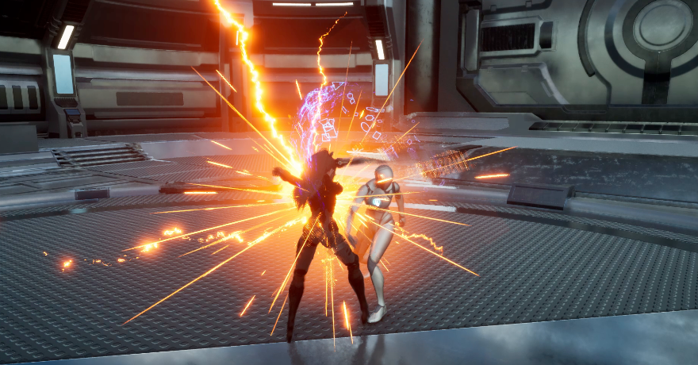
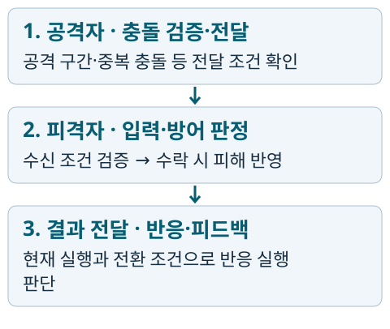
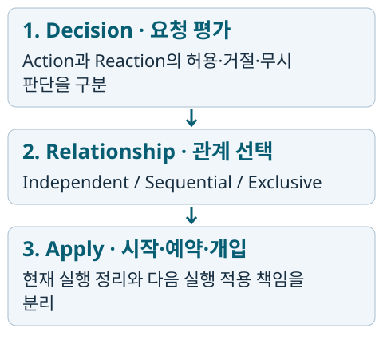
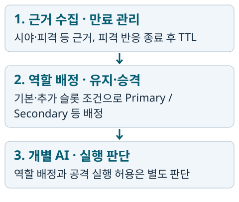
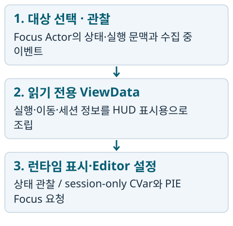

# Project Stellar

전투 실행·판정·반응을 연결하고, 다수 적의 인식과 전투 참여를 다루는 UE5.4 근접 액션 프로젝트입니다.

[프로젝트 웹 페이지](https://razria93.github.io/site/stellar.html) · [프로젝트 PDF](https://razria93.github.io/files/pdf/stellar-review.pdf) · [시연·검증 영상 목록](https://razria93.github.io/Portfolio_UE5.4_verGit/videos/)

[개요](#overview) · [기여](#contribution) · [주요 기능](#features) · [핵심 구현](#implementation) · [문제 해결](#troubleshooting) · [검증·한계](#verification) · [실행 방법](#getting-started)



*실제 플레이 · 패링 장면. 전투·AI 동작과 검증 조건은 연결 자료에서 확인합니다.*

<a id="project-stellar--ue54-근접-액션-프로젝트"></a>
<a id="overview"></a>

## 프로젝트 개요

| 항목 | 내용 |
| --- | --- |
| 목적·성격 | UE5.4 기반 3인칭 근접 액션 게임의 전투·AI 구현 |
| 기간 | 2025.12 시작 · 개발 진행 중(2026.10 자료 기준) |
| 개발·작업 형태 | 1인 개발 · Codex 활용. 실제 작업 범위는 아래 기여 설명 참고 |
| 주요 기능 | 콤보·가드·패링·회피·반격·처형, 공격·피격 전환, 다수 적 전투 역할 배정 |
| 구현·정리 범위 | 게임플레이·전투·AI, 피드백·HUD·디버그 도구, 외부 에셋 가공·설정·통합 |
| 기술 | Unreal Engine 5.4 · C++ · Blueprint |
| 실행 환경 | Windows PC · Visual Studio 2022 · Unreal Editor |
| 결과 확인 | 웹·PDF·시연 자료로 동작과 조건 확인. 로컬 실행은 별도 환경 준비 필요 |

<a id="contribution"></a>

## 작업 범위·기여

**사용자 작업:** 원하는 전투·AI 동작을 요구사항으로 구체화하고, 플레이 결과를 검토하며 보완 방향과 추가 확인 범위를 판단했습니다.

**Codex 작업:** 코드 분석·구현, 자동 검증, 영상·문서 구성을 수행했습니다. 세부 구현의 최초 작성 범위는 확인된 기록에 따라 구분합니다.

**이번 최적화 검증:** 사용자는 측정 범위·환경 운영 조건과 결과 표현 기준을 정하고, Codex는 실행 자동화·측정·집계·근거 정리를 수행했습니다.

외부 캐릭터·모션·무기·환경·VFX·효과음 자체의 제작과 프로젝트에서의 가공·설정·통합은 구분합니다. 새 환경에서 외부 에셋을 포함한 전체 실행을 이번 문서 작업으로 재검증하지 않았습니다.

<a id="대표-영상"></a>
<a id="대표-화면시연"></a>
<a id="주요-기능-시연"></a>
<a id="features"></a>

## 주요 기능·실행 결과

공격·방어와 반격, 균형 붕괴 후 처형, 다수 적의 전투 참여를 연결합니다. 사진은 동작의 한 순간이며 연속 처리와 검증 조건은 각 시연에서 확인합니다.

| 기능 | 확인할 내용 | 시연·PDF |
| --- | --- | --- |
| 가드·패링 | 방어 결과와 양측의 후속 반응 | [프로젝트 PDF · 21–22쪽](https://razria93.github.io/files/pdf/stellar-review.pdf#page=21) · [시연 영상 · 약 1분 14초](https://razria93.github.io/Portfolio_UE5.4_verGit/videos/guard-parry/) |
| 회피·카운터 러시 | 일반·퍼펙트 회피와 반격의 연결 | [프로젝트 PDF · 플레이 범위 · 4쪽](https://razria93.github.io/files/pdf/stellar-review.pdf#page=4) · [시연 영상 · 약 59초](https://razria93.github.io/Portfolio_UE5.4_verGit/videos/dodge-counter/) |
| 균형 붕괴·처형 | 균형 누적, 처형 기회와 양측 실행 | [프로젝트 PDF · 플레이 범위 · 4쪽](https://razria93.github.io/files/pdf/stellar-review.pdf#page=4) · [시연 영상 · 약 1분 29초](https://razria93.github.io/Portfolio_UE5.4_verGit/videos/balance-execution/) |
| 실행 중단·반응 전환 | 기존 실행의 중단·정리 후 새 반응 시작 | [프로젝트 PDF · 19–20쪽](https://razria93.github.io/files/pdf/stellar-review.pdf#page=19) · [시연 영상 · 약 1분 9초](https://razria93.github.io/Portfolio_UE5.4_verGit/videos/execution-transition/) |
| 다수 적 전투 참여 | 교전·경계·관찰 역할과 실제 행동 구분 | [프로젝트 PDF · 23–24쪽](https://razria93.github.io/files/pdf/stellar-review.pdf#page=23) · [시연 영상 · 약 1분 53초](https://razria93.github.io/Portfolio_UE5.4_verGit/videos/combat-participation/) |

[전체 영상 목록](https://razria93.github.io/Portfolio_UE5.4_verGit/videos/)은 본편 14개와 별도 가드 PIE 1개로 구성됩니다. 개별 영상은 당시 조건의 기록이며 현재 main 전체의 재검증을 뜻하지 않습니다.

<a id="implementation"></a>

<a id="대표-구현"></a>

## 핵심 구현·작업 과정

### 공격·피격 처리

**목적:** 공격자의 충돌 전달과 피격자의 피해·방어 판정 책임을 분리하고, 판정 결과를 반응과 피드백에 연결합니다.



*코드·PDF에 근거한 핵심 경로 요약. 거절 경로와 방어별 세부 분기는 아래 설명 및 구현 구조 상세에서 확인합니다.*

**처리 흐름·설계 이유**

1. 공격자가 공격 판정 구간과 중복 충돌 등 전달 조건을 확인하고 충돌 데이터를 전달합니다.
2. 피격자는 입력·현재 상태·방어 정책을 평가합니다. 수락된 결과에 대해 자원 상태를 반영하고 반응·넉백 결과를 구성합니다.
3. 결과 패킷을 반응·피드백·공격자 측 처리에 전달합니다. 피해 반영과 피격 반응의 실행 허용을 분리하여 현재 실행 상태와 전환 조건을 따로 판단합니다.

**확인 결과:** 기존 일반 타격 시연에서 공격 실행 → 충돌·결과 판정 → 피격 반응의 연결을 확인할 수 있습니다. 현재 코드 전체를 새로 실행한 결과는 아닙니다.

**조건·한계:** 지원하지 않는 피해 이벤트나 유효하지 않은 입력은 거절합니다. 수신 조건·방어 결과에 따라 수락되지 않을 수 있으며, 피해 판정이 곧 반응 실행을 뜻하지 않습니다. 이 요약은 일반 타격 경로를 중심으로 하며 처형·타이밍 신호 전체를 대체하지 않습니다.

**관련 자료:** [프로젝트 PDF · 17–18쪽](https://razria93.github.io/files/pdf/stellar-review.pdf#page=17) · [일반 타격 시연 영상](https://razria93.github.io/Portfolio_UE5.4_verGit/videos/general-hit/) · [구현 구조 상세](https://razria93.github.io/site/details/Portfolio_UE5.4_verGit/docs/stellar_resource_catalog_20261021/structure.html#I01) · [피격자 처리 코드](https://github.com/Razria93/Portfolio_UE5.4_verGit/blob/0e0132ac12280ee02eac45dd9068b85ef8f4a745/Source/Portfolio/Component/CCombatSignalTargetComponent.cpp#L171-L267)

<a id="전투-실행반응-전환"></a>

### 실행 중단·반응 전환

**목적:** 새 요청과 현재 실행의 관계를 판단하고, 이전 실행의 자원이 다음 실행에 남지 않도록 정리합니다.



*코드 근거의 실행 전환 요약 · 모든 피드백이 중단 즉시 제거되는 구조는 아닙니다.*

**처리 흐름·설계 이유:** `Decision → Relationship → Apply`를 분리합니다. Action의 `Independent / Sequential / Exclusive` 관계에 따라 `Start / Reserve / Intervene`을 적용하며 거부·무시 경로도 유지합니다. 공격 중 피격되면 반응의 중단 요구와 현재 공격의 중단 허용을 함께 확인합니다. 조건을 충족하면 충돌·트레일·실행 문맥을 정리하고 종료를 통지한 뒤 새 반응을 시작합니다.

**확인 결과:** 기존 시연에서 실행 중단과 피격 반응 전환을 관찰할 수 있습니다. 구조 문서는 당시 설계 기록이며 현재 전체 코드의 동작을 다시 검증한 결과가 아닙니다.

**조건·한계:** Action과 Reaction 정책은 같지 않습니다. Reaction은 순차 실행을 지원하지 않으며 Dodge Action은 리액션 중 요청을 거절합니다. Dead Reaction은 별도 강제 개입 경로입니다. 일회성 Niagara·효과음·성공 연출의 수명은 실행 자원 정리와 구분합니다.

**관련 자료:** [프로젝트 PDF · 19–20쪽](https://razria93.github.io/files/pdf/stellar-review.pdf#page=19) · [실행 전환 시연 영상](https://razria93.github.io/Portfolio_UE5.4_verGit/videos/execution-transition/) · [실행 구조 상세](https://razria93.github.io/site/details/Portfolio_UE5.4_verGit/docs/stellar_resource_catalog_20261021/structure.html#execution) · [당시 설계 문서](https://github.com/Razria93/Portfolio_UE5.4_verGit/blob/0e0132ac12280ee02eac45dd9068b85ef8f4a745/Docs/05_System_Architecture/S37_UE5_Portfolio_Execution_Transition_and_Intervention_Architecture.md)

<a id="다수-적-전투-역할-배정"></a>

### 전투 참여 역할 배정

**목적:** 다수 적이 동일 대상을 인지한 상황에서 참여 근거와 역할별 한도로 전투 참여를 조정합니다.



*역할 배정은 실제 공격 실행과 별개입니다.*

**처리 흐름·설계 이유:** 인지·피격 근거와 후보를 모아 정렬하고, 기존 역할 유지·승격·신규 배정을 수행합니다. 교전 총한도 내에서 기본 자리와 피격 근거가 있는 추가 자리를 구분합니다. 각 AI는 배정 역할 외에도 현재 실행 상태와 거리를 확인하여 행동을 결정합니다.

**확인 결과:** 교전·경계·관찰 역할과 실제 행동은 기존 다수 적 전투 시연에서 확인합니다.

**조건·한계:** 피격 근거의 유지·만료와 현재 타깃 선택, 이후 Investigate 행동 전환을 구분합니다. 역할을 배정받았다는 사실이 즉시 공격한다는 뜻은 아닙니다. 인원·상한 값은 연결된 정책과 해당 시연 조건을 따르며 임의의 최대 처리 성능을 주장하지 않습니다.

**관련 자료:** [프로젝트 PDF · 23–24쪽](https://razria93.github.io/files/pdf/stellar-review.pdf#page=23) · [전투 참여 시연 영상](https://razria93.github.io/Portfolio_UE5.4_verGit/videos/combat-participation/) · [참여 구조 상세](https://razria93.github.io/site/details/Portfolio_UE5.4_verGit/docs/stellar_resource_catalog_20261021/structure.html#I08) · [참여 정책](https://github.com/Razria93/Portfolio_UE5.4_verGit/blob/0e0132ac12280ee02eac45dd9068b85ef8f4a745/Docs/05_System_Architecture/S34_UE5_Portfolio_Combat_Participation_Policy.md)

<a id="런타임-관찰과-에디터-도구"></a>
참여 수와 갱신 정책의 비용은 [다수 AI 처리 비용 개선](#optimization)의 별도 통제 실험에서 확인했습니다. 기존 역할 배정 시연의 설정과 구분합니다.

<a id="디버그-오버레이"></a>

### 디버그 오버레이·개발 지원

**목적:** 결과 화면만으로 알기 어려운 Actor 상태와 실행 판단을 같은 관찰 대상으로 대조합니다.



*읽기 전용 관찰 데이터와 게임플레이 판정을 구분합니다.*

**처리 흐름·설계 이유:** 전투·이동·실행 세션과 Event Log를 Focus 대상의 읽기 전용 ViewData로 조립해 HUD에 표시합니다. 실행 결정·적용 방식·거절 이유를 구분해 기록합니다. Editor Panel은 session-only CVar 설정과 PIE Focus 요청을 연결하며 게임플레이 상태를 변경하지 않습니다.

**확인 결과:** 기존 디버그 시연과 코드에서 현재 상태·최근 사건·Focus 기반 관찰 경로를 확인할 수 있습니다.

**조건·한계:** 최근 사건과 현재 Actor 상태가 같은 시점의 실행을 나타내지는 않을 수 있습니다. 참조 조사용 Asset Reference Inspector와 Track 검증·백업·Revert를 지원하는 Root Motion Tool은 별도 에디터 지원 경로입니다. 모션·에셋 자체의 제작과 가공·도구 구현을 구분합니다.

**관련 자료:** [프로젝트 PDF · 25–26쪽](https://razria93.github.io/files/pdf/stellar-review.pdf#page=25) · [디버그 도구 시연 영상](https://razria93.github.io/Portfolio_UE5.4_verGit/videos/debug-overlay/) · [관찰 도구 구조](https://razria93.github.io/site/details/Portfolio_UE5.4_verGit/docs/stellar_resource_catalog_20261021/structure.html#tools) · [추가 기술·개발 문서](Docs/Portfolio/technical-notes.md)

[전체 구현 구조 보기](https://razria93.github.io/site/details/Portfolio_UE5.4_verGit/docs/stellar_resource_catalog_20261021/structure.html#overview)

<a id="troubleshooting"></a>

## 문제 해결


<a id="인식-지연-개선"></a>

### 다수 AI 인식 지연

**증상·영향:** 적 수가 늘어날 때 플레이어를 처음 유효 대상으로 인식하기까지 지연이 커졌습니다.

**원인·근거:** 같은 편 Enemy가 Sight 감지 단계의 대상에 포함돼 있었습니다. 같은 배치·카메라에서 감지 대상 제외 전후를 대조했습니다.

**수정·선택 이유:** 같은 편 Enemy를 감지 단계에서 제외하여 인지 후보 범위를 줄였습니다.

**검증·결과**

| 확인 방법 | 확인한 결과 |
| --- | --- |
| 최초 유효 대상 인식 지연 · 120마리 | 120마리 조건의 최초 유효 대상 인식 지연 p95는 **20.816초 → 1.053초**입니다. 실행별 p95의 3회 중앙값이며 전후 모든 실행에서 플레이어 인식 완료를 확인했습니다. |
| 전체 프레임 시간 · 같은 120마리 조건 | 전체 프레임 p95는 **20.7365 → 21.1009ms**로 개선되지 않았습니다. 인식 지연 지표의 개선과 구분합니다. |

**조건·한계:** 2026.10.02, UE 5.4.4·Windows 11·D3D12·Development, Ryzen 9 7950X3D·RTX 4070 Ti. 40·80·120마리, 전후 각 3회·회당 40초·녹화 없이 측정했습니다. 개체 수별 동일 배치·카메라 조건이며 **해당 측정에서 전체 프레임 p95는 개선되지 않았습니다**. 당시 측정 결과를 현재 main 성능으로 확대하지 않습니다.

**관련 자료:** [프로젝트 PDF · 5–7쪽](https://razria93.github.io/files/pdf/stellar-review.pdf#page=5) · [AI 인지 지연 비교 영상](https://razria93.github.io/Portfolio_UE5.4_verGit/videos/ai-perception/) · [측정 조건·전체 결과](https://razria93.github.io/site/details/Portfolio_UE5.4_verGit/docs/stellar_troubleshooting_verification_20261022/ai.html)

<a id="optimization"></a>


### 다수 AI 처리 비용 개선

**증상·영향:** 공격 참여를 2명으로 제한해도 나머지 AI가 경계 행동을 계속하면, 개체 수가 늘수록 프레임 시간이 증가했습니다.

**원인·근거:** 80–160마리에서 Frame과 Game 시간이 가깝고 참여 제한 이후 함께 감소했습니다. 게임 스레드 쪽 부담을 지지하는 결과이며, 특정 이동 함수의 비용을 새 Trace로 확정한 것은 아닙니다.

**수정·선택 이유:** 경계 참여 수 제한과 행동 판단 갱신 간격을 별도로 제어했습니다. 참여 조건 U는 Engage 2·나머지 Alert, L은 Engage 2·Alert 6·나머지 None입니다. Observe는 두 조건 모두 0명입니다. `UpdateAIIntentState`의 갱신은 역할·상태 tier에 따라 모드 0의 0.2초에서 모드 2의 0.2·0.3·0.5초로 구분하며, AIContext·EngageContext는 0.1초를 유지합니다.

**검증·결과**

| 비교 · 160마리 | 확인한 결과 | 해석 |
| --- | --- | --- |
| 참여 제한 · 갱신 모드 0 고정, U0→L0 | Frame p95 **22.3505→16.8966ms, 24.40% 감소** | 80·120마리는 각각 14.19%·20.74%, 40마리는 0.59%로 차이가 작았습니다. |
| 갱신 조절 · 참여 제한 L 고정, L0→L2 | 행동 판단 호출 **764→329.25회/초, 56.90% 감소** | 특정 BT 서비스의 호출수입니다. 전체 AI 비용 감소율이 아닙니다. |
| 갱신 조절의 추가 프레임 효과 | 160마리 16.8966→16.1889ms | 반복 범위가 겹치고 규모별 변화가 일정하지 않아 안정적인 추가 프레임 개선으로 단정하지 않습니다. |

**조건·한계:** 2026.10.29, UE5.4.4·Windows 11·Ryzen 9 7950X3D·RTX 4070 Ti·D3D12·1920×1080·품질 3. 같은 실험 실행 파일·시드 11·배치·카메라와 실제 캡슐 반경 10을 사용했습니다. 40·80·120·160마리 × 6조건 × 3회, **정식 72회**이며 예비 2회는 제외합니다. 매회 준비 10초+측정 40초, 녹화 없이 측정했습니다. 시간은 실행별 p95의 3회 중앙값, 호출수는 실행별 초당 평균의 3회 중앙값입니다.

역할·인지·이동 발생·공격·피해는 시험 범위에서 확인했습니다. 42/72회에 Alert 저속 이동 구간과 밀집 배치의 메시 겹침이 있었고 기존 Niagara 오류도 남았습니다. 새 상세 Trace는 수집하지 않았으며 자연스러운 군중 회피나 모든 전투 상황을 검증한 결과가 아닙니다. 공개 main과 실험본은 기본 설정·일부 이동 실패 대응이 달라 **현재 공개 빌드의 기본 성능으로 일반화하지 않습니다.** 기존 인식 지연 사례와 이번 결과를 합산하지 않습니다.

**관련 자료:** [프로젝트 PDF · 8–10쪽](https://razria93.github.io/files/pdf/stellar-review.pdf#page=8) · [측정·검증 자료](https://razria93.github.io/site/evidence/Portfolio_UE5.4_verGit/docs/stellar_optimization/index.html)

<a id="피격-후-타깃-유지"></a>

### 피격 반응 후 공격자 타깃 유지

**증상·영향:** 후방에서 피격된 적이 반응을 마친 뒤 공격자를 향해 돌아보지 않았습니다.

**원인·근거:** 피격 수락 시 등록한 근거의 유지 시간(TTL)이 반응 중 소모되어, 종료 시점에 이미 만료됐습니다.

**수정·선택 이유:** 근거 등록은 피격 수락 시 유지하고, TTL 감소 시작을 해당 피격 반응 종료 이후로 옮겼습니다. `ResultSerial`로 피격·공격자를 연결하여 이전 종료 알림과 현재 기록을 구분합니다.

**검증·결과**

| 확인 방법 | 확인한 결과 |
| --- | --- |
| NullRHI 자동 검사 · 4그룹·19시나리오 | 늦거나 중복된 종료 알림, 요청 거절·중단, 공격자별 독립 만료 등 검사 통과 |
| 같은 공격자 연속 피격 검사 | 마지막 반응 종료 0.50초 → 만료 1.50초. 0.70초의 이전·중복 종료 알림에도 만료 시각 유지. 1.60초에 만료 확인 |
| 별도 실제 시연 · TTL 1초 | 피격 반응 종료 후 대상 추적과 Tracking 전환 확인 |

**조건·한계:** 수정 전 영상은 정책 복원 시연이며 당시 바이너리가 아닙니다. 기록 유지와 현재 타깃 선택은 별개이고, 후속 Investigate는 비교에서 제외했습니다. 공격자 소멸 후 대기 기록 정리 보완안은 원본 미반영입니다. 위 결과는 보존된 검증 기록이며 이번 README 작업에서 자동 검사나 PIE를 다시 실행하지 않았습니다.

**관련 자료:** [프로젝트 PDF · 11–13쪽](https://razria93.github.io/files/pdf/stellar-review.pdf#page=11) · [타깃 유지 시연 영상](https://razria93.github.io/Portfolio_UE5.4_verGit/videos/hit-target-ttl/) · [검증 기록·경계 조건](https://razria93.github.io/site/details/Portfolio_UE5.4_verGit/docs/stellar_troubleshooting_verification_20261022/ttl.html#boundary) · [TTL 시작 코드](https://github.com/Razria93/Portfolio_UE5.4_verGit/blob/0e0132ac12280ee02eac45dd9068b85ef8f4a745/Source/Portfolio/System/Combat/CWorldSubsystem_CombatParticipation.cpp#L226-L240)

### 가드 종료 중 피격 전환

**증상·영향:** 가드 종료와 피격이 겹치면 피격 반응으로 전환하는 정리 경로에서 문제가 발생했습니다.

**원인·근거:** 이미 비워진 가드 상태에 대한 정리 요청이 거절되어 후속 피격 전환이 막혔습니다.

**수정·선택 이유:** 이미 정리된 가드 상태의 정리 요청도 수락하도록 보완했습니다.

**검증·결과**

| 확인 방법 | 확인한 결과 |
| --- | --- |
| 실제 격리 PIE | 피격 반응 실행, 기본 이동 속도 설정 복원, 다음 가드 실행을 확인했습니다. |
| 정리 호출 반복 검사 | **자동 검사 24조건 × 25회, 정리 호출 600회**. 실제 격리 PIE와 구분합니다. |

**조건·한계:** 요청은 재현 코드에서 실행했고, 600회는 실제 전투 횟수가 아닙니다. 실제 PIE의 Run 600과 자동 검사의 Run 420·Sprint 620, 기존 시연 피해 20과 검증 피해 300을 구분합니다. 복원은 기본 이동 속도 설정의 복원이며 달리기 동작 재개를 확인한 검사가 아닙니다. Sprint 유지·800 복원·수동 PIE 이펙트 동등성은 미확인입니다.

**관련 자료:** [프로젝트 PDF · 14–16쪽](https://razria93.github.io/files/pdf/stellar-review.pdf#page=14) · [가드 피격 전환 시연 영상](https://razria93.github.io/Portfolio_UE5.4_verGit/videos/guard-hit-transition/) · [별도 가드 PIE 영상](https://razria93.github.io/Portfolio_UE5.4_verGit/videos/guard-pie/) · [자동 검사·확인 범위](https://razria93.github.io/site/details/Portfolio_UE5.4_verGit/docs/stellar_troubleshooting_verification_20261022/guard.html#repeat)

<a id="검증-조건한계"></a>
<a id="사례별-검증-조건결과한계"></a>
<a id="verification"></a>

## 검증 범위·알려진 한계

다수 AI 처리 비용 사례는 별도 실험 실행 파일의 통제 비교입니다. 기존 인식 지연 측정·타깃 유지·가드 검사와 조건 및 확인 방법이 다릅니다. [최적화 사례의 조건·한계](#optimization)를 함께 확인합니다.

사례별 환경·방법·결과·한계는 위 설명에 함께 기재했습니다. 인식 지연은 당시 성능 측정, 타깃 유지는 정책 복원 비교·자동 검사·실제 Tracking 시연, 가드는 격리 PIE·정리 호출 반복 검사입니다. 서로 다른 확인 방법과 숫자를 같은 성능·완성도 지표로 합치지 않습니다.

각 결과는 기록 당시 조건이며 현재 main 전체를 재검증한 결과가 아닙니다. 새 환경의 외부 에셋을 포함한 전체 실행, 미확인 범위와 원본 미반영 보완안을 구분합니다.

<a id="local-run"></a>

<a id="프로젝트-실행-안내"></a>
<a id="getting-started"></a>

<a id="로컬-실행"></a>

## 실행 환경·시작 방법

<a id="실행-환경준비"></a>
<a id="저장소환경-준비"></a>

### 준비

Windows PC, Unreal Engine **5.4**, Visual Studio 2022 C++ 개발 환경, Git·Git LFS를 준비합니다.

```powershell
git lfs install
git clone https://github.com/Razria93/Portfolio_UE5.4_verGit.git
cd Portfolio_UE5.4_verGit
git lfs pull
```

`.uasset`·`.umap`은 Git LFS 추적 대상입니다. 외부 에셋의 준비·사용권은 [에셋 출처 안내](https://razria93.github.io/site/details/Portfolio_UE5.4_verGit/docs/stellar_resource_catalog_20261021/assets.html)를 확인합니다.

<a id="프로젝트-실행"></a>
<a id="에디터에서-실행"></a>

### 실행 절차

1. `Portfolio.uproject`를 열고 필요한 경우 Visual Studio project files를 생성합니다.
2. `PortfolioEditor | Win64 | Development`로 빌드합니다.
3. Editor에서 `TestRoom`을 엽니다.
4. **Play(PIE)**로 실행하고 Player / Enemy의 전투 동작을 확인합니다.

<a id="실행-후-확인"></a>

### 정상 결과·문제 발생 시

전투 장면과 플레이어·적이 나타나는지 확인하고, Debug Overlay에서 전투·실행 상태를 관찰합니다. 포함된 Editor 플러그인은 `PortfolioDebugOverlayEditor`, `AssetReferenceInspector`입니다.

| 상황 | 확인할 항목 |
| --- | --- |
| 에셋·맵이 없거나 열리지 않음 | Git LFS 실제 파일 다운로드 여부와 외부 에셋 준비 조건 확인 |
| 프로젝트·모듈 빌드 실패 | UE 5.4와 C++ 도구 설치, Editor Target·Win64·Development 구성, 첫 컴파일 오류 확인 |
| 시연과 다른 동작 | 사용한 코드·에셋 버전과 시연의 검증 조건을 먼저 대조 |

새 환경 전체 실행은 이번 문서 정리에서 재검증하지 않았습니다. 결과를 먼저 확인하려면 웹·PDF·영상 자료를 사용하고, 로컬 실행은 코드·도구를 더 깊이 살펴보는 경로로 제공합니다.

<a id="repository"></a>

## 저장소 구조

| 경로 | 역할 |
| --- | --- |
| [Source/Portfolio](https://github.com/Razria93/Portfolio_UE5.4_verGit/tree/main/Source/Portfolio) | 게임플레이·전투·AI·런타임 디버그 |
| [Source/PortfolioEditor](https://github.com/Razria93/Portfolio_UE5.4_verGit/tree/main/Source/PortfolioEditor) | Root Motion 등 에디터 확장 |
| [Plugins](https://github.com/Razria93/Portfolio_UE5.4_verGit/tree/main/Plugins) | Asset Reference Inspector·Debug Overlay Editor |
| [Config](https://github.com/Razria93/Portfolio_UE5.4_verGit/tree/main/Config) · [Portfolio.uproject](https://github.com/Razria93/Portfolio_UE5.4_verGit/blob/main/Portfolio.uproject) | 설정·실행 진입점 |
| [Docs](https://github.com/Razria93/Portfolio_UE5.4_verGit/tree/main/Docs) | 설계·작업 기록·검증 근거 |
| [portfolio-web](https://github.com/Razria93/Portfolio_UE5.4_verGit/blob/main/portfolio-web/README.md) | 공개 자료 구성·관리 안내 |

<a id="관련-자료"></a>
<a id="설계코드-탐색"></a>
<a id="포트폴리오-자료"></a>
<a id="documents"></a>

## 관련 문서

| 목적 | 문서 |
| --- | --- |
| 전체 구현 구조 | [웹 구조 상세](https://razria93.github.io/site/details/Portfolio_UE5.4_verGit/docs/stellar_resource_catalog_20261021/structure.html) · [설계 문서 색인](https://github.com/Razria93/Portfolio_UE5.4_verGit/blob/main/Docs/05_System_Architecture/00_System_Architecture_Index.md) |
| 추가 기술·코드 탐색 | [실행 정책·관찰·에디터 도구](Docs/Portfolio/technical-notes.md) · [실행 타입](https://github.com/Razria93/Portfolio_UE5.4_verGit/blob/main/Source/Portfolio/Type/CExecutionTypes.h) |
| 제출 기록·자료 관리 | [과거 제출 자료와 관리 기준](Docs/Portfolio/history.md) |
| 세 프로젝트 안내 | [통합 PDF](https://razria93.github.io/files/pdf/combined-review.pdf) · [통합 포트폴리오](https://razria93.github.io/) |


<a id="technical-appendix"></a>

### 추가 기술·보존 기록 바로가기

긴 기술 설명과 이전 제출 기록은 다음 상세 절에서 확인합니다.

- <a id="1-action--reaction-실행-정책"></a>[Action / Reaction 실행 정책](Docs/Portfolio/technical-notes.md#execution-policy)
- <a id="2-focus-기반-runtime-debug-overlay"></a>[Focus 기반 Runtime Debug Overlay](Docs/Portfolio/technical-notes.md#runtime-observation)
- <a id="3-조사복구-경로를-갖는-editor-tooling"></a>[조사·복구 경로를 갖는 Editor Tooling](Docs/Portfolio/technical-notes.md#editor-tooling)
- <a id="2026-10-23-제출-자료-보존"></a>[2026-10-23 제출 자료 보존](Docs/Portfolio/history.md#submission-20261023)
- <a id="기존-개별-사이트-관리"></a>[기존 개별 사이트 관리](Docs/Portfolio/history.md#site-maintenance)
- <a id="후속-근거-관리"></a>[후속 근거 관리](Docs/Portfolio/history.md#evidence-maintenance)

<a id="저장소-공개-범위"></a>
<a id="sources"></a>

<a id="출처공개-범위문의"></a>

## 출처·공개 범위

공개 검토 범위는 `Source/`·`Config/`·`Plugins/`·`Docs/` 및 프로젝트 구성에 필요한 파일입니다. 새 `.uasset`·`.umap`은 forward-only Git LFS 정책으로 추적하고 기존 이력은 변환하지 않습니다.

`Binaries/`·`Build/`·`DerivedDataCache/`·`Intermediate/`·`Saved/`·`.vs/`·`output/`과 로컬 프로파일링 캡처는 제외합니다. 외부 에셋 재배포 권한은 개별 라이선스를 따르며 이 문서가 별도 사용권을 부여하지 않습니다.

외부 캐릭터·모션·무기·환경·VFX·효과음의 제작 기여와 프로젝트의 가공·설정·게임플레이 통합을 구분합니다. [외부 에셋 출처](https://razria93.github.io/site/details/Portfolio_UE5.4_verGit/docs/stellar_resource_catalog_20261021/assets.html)를 참고하세요. 별도 문의 주소는 이 문서에 지정하지 않습니다.
