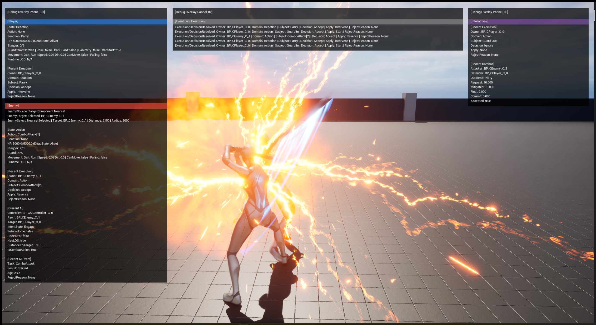

# Project Stellar — UE5.4 C++ 액션 RPG

Player와 Enemy의 공통 전투 실행 구조를 중심으로, 타깃 관리와 두 Actor의 처형 협업을 구현한 3인칭 액션 RPG 개인 프로젝트입니다. 전투 상태를 관찰하는 런타임 디버그 도구와 구현·문제 해결·검증 자료를 함께 제공합니다.

[화면으로 보기](https://razria93.github.io/Portfolio_UE5.4_verGit/) · [영상 목록·공개 상태](Docs/07_Portfolio_Documents/Portfolio_Production/Video_Catalog.md) · [핵심 구현](#combat-systems) · [문제 해결](#problem-solving) · [코드 읽기](#code-guide) · [전체 문서](Docs/00_Documentation_Index.md)

전투 결과와 실행 상태를 함께 관찰하는 화면입니다. [웹 포트폴리오](https://razria93.github.io/Portfolio_UE5.4_verGit/)에서 대표 장면과 설명을 볼 수 있습니다. 기존 설명 영상은 [가드](https://youtu.be/wm57Nbvs8OI) · [TTL 이전 버전](https://youtu.be/3wiZNXvtokM) · [AI 개선](https://youtu.be/fGTAndeuBo8)에서 볼 수 있습니다. **최신 TTL 재촬영본은 38.8초이며, 공개된 37초 영상과 다릅니다.** [영상 목록](Docs/07_Portfolio_Documents/Portfolio_Production/Video_Catalog.md)에서 최신 제작본과 외부 링크의 상태를 구분합니다.

## 개발 정보와 기여 범위

| 항목 | 내용 |
| --- | --- |
| 기간 / 인원 | 2025.12 ~ 현재 / 1인 개발 |
| 역할 | C++ Game Programmer |
| 환경 | Unreal Engine 5.4 / C++ · Blueprint / Windows / Visual Studio 2022 |
| 직접 설계·구현 | Action/Reaction 실행 정책, 공통 Combat Target, Enemy 전투 참여, 처형 협업, Runtime Debug Overlay, Editor Tooling |
| 에셋 통합 작업 | 캐릭터 리타게팅, 무기 Socket·Pivot·Trail 연동, Montage 설정과 종료 흐름 정리 |
| 외부 에셋 활용 | 캐릭터·무기·환경 에셋을 활용했습니다. 원본 아트 제작과 코드·설정·통합 기여를 구분하며, 상세 범위는 [에셋 통합 기록](Docs/07_Portfolio_Documents/Stellar_Asset_Integration/README.md)에 정리했습니다. |

**추천 열람 순서:** 대표 화면 → 아래 전투 시스템 중 관심 항목 → 문제 해결 사례 → 해당 코드와 검증 자료. 각 설명에서 상세 문서로 직접 이동할 수 있습니다.

## 핵심 전투 시스템

### 1. Action / Reaction 실행 정책

공격·연속 행동·피격이 겹칠 때, 새 요청의 수락 여부와 기존 실행을 정리할 책임을 분리했습니다. Player와 Enemy가 같은 실행 정책을 사용하며, Action과 Reaction은 각자의 Orchestrator와 실행 객체를 유지합니다.

- **판단:** 실행 가능 여부(Decision), 현재 실행과의 관계(Relationship), 실제 적용(Apply)을 단계별로 구분합니다.
- **적용:** 실행이 없으면 시작하고, Action 연속 실행은 예약하며, 배타적 개입은 기존 실행을 중단한 뒤 시작합니다. Reaction은 연속 예약을 지원하지 않습니다.
- **확인 범위:** 현행 코드 구조를 문서화했습니다. 모든 전환·종료 경로의 제출용 런타임 캡처가 완료됐다는 의미는 아닙니다.

[설계와 근거 범위 — S37](Docs/05_System_Architecture/S37_UE5_Portfolio_Execution_Transition_and_Intervention_Architecture.md) · [Action Orchestrator](Source/Portfolio/Component/CActionOrchestratorComponent.cpp) · [Reaction Orchestrator](Source/Portfolio/Component/CReactionOrchestratorComponent.cpp)

### 2. 공통 타깃 관리와 Enemy 전투 참여

전투 대상의 상태는 Combat Target에 모으고, Enemy가 전투에 참여할지는 별도 정책으로 결정합니다. 인지·피격 정보의 유효 기간과 참여 결과를 연결해, 오래된 정보가 뒤늦게 현재 타깃을 바꾸지 않도록 처리합니다.

- **타깃 관리:** 대상과 Revision을 함께 확인해 지연된 요청·해제와 현재 대상 변경을 구분합니다.
- **참여 정책:** 유효한 인지·피격 근거를 바탕으로 None / Observe / Alert / Engage를 배정하고, 결과를 Target·Facing·Blackboard·Intent에 반영합니다.
- **확인 범위:** S33·S34에 구현 및 정적·PIE 검증 상태와 수동 확인 항목을 기록했습니다.

[타깃 구조 — S33](Docs/05_System_Architecture/S33_UE5_Portfolio_System_Architecture.md) · [참여 정책 — S34](Docs/05_System_Architecture/S34_UE5_Portfolio_Combat_Participation_Policy.md) · [타깃 코드](Source/Portfolio/Component/CCombatTargetComponent.cpp) · [참여 배정 코드](Source/Portfolio/System/Combat/CWorldSubsystem_CombatParticipation.cpp)

### 3. 두 Actor의 처형 협업

공격자와 대상이 하나의 처형 세션을 공유하도록 구성했습니다. 각 Actor 내부의 Action/Reaction 실행과, 두 Actor 사이의 예약·취소·결과 확정을 분리했습니다.

- **시작:** 타깃과 처형 기회를 확인하고, 대상 Reaction과 공격자 Action을 연결합니다.
- **결과:** 대상이 Standard / Lethal 결과를 결정합니다. Commit 이전 취소와 이후 결과 확정을 구분하고, 회복 또는 사망 연출로 이어갑니다.
- **확인 범위:** 구현과 에셋 설정이 반영되어 있으며 결과별 회귀 검증·제출용 캡처는 보완 중입니다. 네트워크 동기화는 범위 밖입니다.

[처형 협업과 검증 항목 — S36](Docs/05_System_Architecture/S36_UE5_Portfolio_Execution_Collaboration_Architecture.md) · [협업 코드](Source/Portfolio/Component/CExecutionCollaborationComponent.cpp) · [피해·결과 판정 경계 — S38](Docs/05_System_Architecture/S38_UE5_Portfolio_Combat_Signal_Architecture.md)

## 대표 문제 해결

| 사례 | 문제 → 해결 → 확인 결과 | 상세 설명과 근거 |
| --- | --- | --- |
| **가드 종료 중 피격 누락** | GuardOut 중단 뒤 이미 정리된 상태를 다시 정리하려다 Hit가 거부됨 → 반복 정리를 수락하도록 변경 → 경계 자동화 3개 테스트와 실제 충돌 후 Hit·다음 가드 복귀 확인 | [원인·코드·검증 범위](Docs/03_Issue_Analysis_Report/I09_Guard_Cleanup_Case_Study.md) |
| **피격 근거 TTL** | 피격 동작 중 공격자 정보 만료 → Reaction 종료부터 TTL 계산, ResultSerial로 오래된 종료 차단 → 4그룹·19시나리오 관찰. **파괴된 공격자의 Pending 잔여는 후속 보완 필요** | [재촬영·시리얼 검증·남은 문제](Docs/03_Issue_Analysis_Report/I10_HitReactive_TTL_Case_Study.md) |
| **AI Perception 개선** | 불필요한 인지 대상 유입 → Team Attitude·Sight 필터 조정 → 18회 반복 측정. 120개체 첫 인지 p95 중앙값 **20.816→1.053초**, Perception **1.2582→0.1199ms** | [환경·18회 결과·기능 보존 범위](Docs/03_Issue_Analysis_Report/I11_AI_Perception_Case_Study.md) |

가드·TTL의 최신 검증은 2026-10-21 로컬 스냅샷, TTL 영상은 10월 1일 보존 환경, AI 측정은 10월 2일 기준입니다. 로컬 스냅샷과 저장소 전체 소스는 다르므로 **이 PR 전체의 테스트 통과로 해석하지 않습니다.** [검증 근거와 코드 대조](Docs/98_Evidence/Combat_Case_Studies_20261021/README.md)에 적용 범위를 기록했습니다. AI의 전체 프레임 시간은 개선되지 않았으며 FPS 개선으로 확대하지 않습니다.

추가 사례: [무기 Socket·Pivot](Docs/03_Issue_Analysis_Report/I04_UE5_Portfolio_Issue_Analysis_Report.md) · [Montage 종료 설정](Docs/03_Issue_Analysis_Report/I06_UE5_Portfolio_Issue_Analysis_Report.md) · [넉백·공격 방향 보정](Docs/07_Portfolio_Documents/Portfolio_Production/37_Gameplay_Knockback_and_Facing_Review_Guide.md).

## 런타임 관찰과 개발 도구

| 도구 | 사용 목적 | 자료 |
| --- | --- | --- |
| Runtime Debug Overlay | Focus 대상의 전투·이동·실행 상태와 Event Log를 함께 확인 | [화면과 설명](https://razria93.github.io/Portfolio_UE5.4_verGit/#runtime-debug) · [HUD 코드](Source/Portfolio/Core/Debug/CDebugOverlayHUD.cpp) |
| Overlay Editor Panel | session-only CVar와 PIE Focus를 연결해 관찰 대상을 조정 | [Editor 연동 설명](https://razria93.github.io/Portfolio_UE5.4_verGit/#overlay-editor-plugin) |
| Asset Reference Inspector | 에셋 Dependencies / Referencers를 조사하고 검토 후보와 CSV를 제공 | [스텔라 적용 기록](Docs/03_Issue_Analysis_Report/I08_UE5_Portfolio_Issue_Analysis_Report.md) · [플러그인 프로젝트](https://github.com/Razria93/Plugin_Portfolio_UE5.4) |
| Root Motion Tool | 변환 전 Track 검증·백업과 Revert 복구 | [설명](https://razria93.github.io/Portfolio_UE5.4_verGit/#root-motion-tool) · [구현](Source/PortfolioEditor/Private/Animation/CAnimModifier_TransferBodyMotionToRoot.cpp) |

Overlay는 읽기 전용 상태 관찰을 담당합니다. Inspector의 unused 표시는 삭제 가능 판정이 아닌 검토 후보이며, 스텔라 적용 기록에서 확인한 범위와 도구 전체 기능은 구분합니다.

## 코드 읽기 안내

관심 있는 시스템의 한 행부터 읽으면 됩니다. 시스템별 상세 설명은 [현재 시스템 구조 안내](Docs/05_System_Architecture/00_System_Architecture_Index.md)에서 확인할 수 있습니다.

| 관심 주제 | 먼저 읽을 코드 | 이어서 볼 코드 |
| --- | --- | --- |
| 실행 판단 → 적용 | [실행 타입](Source/Portfolio/Type/CExecutionTypes.h) → [Action Orchestrator](Source/Portfolio/Component/CActionOrchestratorComponent.cpp) | [Action Component](Source/Portfolio/Component/CActionComponent.cpp), [Reaction Orchestrator](Source/Portfolio/Component/CReactionOrchestratorComponent.cpp) |
| 타깃 → 참여 배정 → AI 반영 | [Combat Target](Source/Portfolio/Component/CCombatTargetComponent.cpp) → [참여 배정](Source/Portfolio/System/Combat/CWorldSubsystem_CombatParticipation.cpp) | [Enemy 참여 Component](Source/Portfolio/Component/CEnemyCombatParticipationComponent.cpp) |
| 처형 시작 → 확정·취소 | [Execution Collaboration](Source/Portfolio/Component/CExecutionCollaborationComponent.cpp) | [Balance](Source/Portfolio/Component/CBalanceComponent.cpp), [Combat Signal Target](Source/Portfolio/Component/CCombatSignalTargetComponent.cpp) |
| 가드 정리 → 피격 실행 | [Defense](Source/Portfolio/Component/CDefenseComponent.cpp) → [Reaction Orchestrator](Source/Portfolio/Component/CReactionOrchestratorComponent.cpp) | [가드 사례](Docs/03_Issue_Analysis_Report/I09_Guard_Cleanup_Case_Study.md) |
| 피격 수락 → TTL 시작 | [EnemyHitReactive](Source/Portfolio/Component/CEnemyHitReactiveComponent.cpp) → [참여 배정](Source/Portfolio/System/Combat/CWorldSubsystem_CombatParticipation.cpp) | [TTL 사례](Docs/03_Issue_Analysis_Report/I10_HitReactive_TTL_Case_Study.md) |
| 인지 대상 → 필터 설정 | [AI Controller](Source/Portfolio/Controller/CAIController.cpp) | [AI 측정 사례](Docs/03_Issue_Analysis_Report/I11_AI_Perception_Case_Study.md) |
| 무기 표현 → 복구 | [Weapon Actor](Source/Portfolio/Weapon/CWeaponActor.cpp) | [Weapon Component](Source/Portfolio/Component/CWeaponComponent.cpp) |

## 로컬 실행과 확인 범위

1. Unreal Engine **5.4**, Visual Studio 2022 C++ 개발 환경과 Git LFS를 준비합니다.
2. 저장소를 clone하고 저장소 루트에서 `git lfs pull`로 LFS 에셋을 받습니다.
3. `Portfolio.uproject`의 Visual Studio project files를 생성하고 `PortfolioEditor | Win64 | Development`로 빌드합니다.
4. Editor에서 `Content/00_UnitTest/TestRoom`을 열어 Player / Enemy 전투와 Debug Overlay를 확인합니다.

기존 빌드·자동 검사·PIE 결과는 각 기술 문서에 기준 커밋과 함께 기록되어 있습니다. [넉백·방향 보정 검토 가이드](Docs/07_Portfolio_Documents/Portfolio_Production/37_Gameplay_Knockback_and_Facing_Review_Guide.md)에는 실행 명령, 검사 결과, 미확인 조건이 있습니다. 해당 결과는 모든 애니메이션 조합이나 패키징 환경의 검증을 포함하지 않습니다.

## 상세 문서와 관련 프로젝트

- [목적별 문서 안내](Docs/00_Documentation_Index.md): 전투 구조, 문제 해결, 코드·검증 경로
- [문제 해결 사례 전체](Docs/03_Issue_Analysis_Report/00_Issue_Analysis_Report_Index.md): 에셋 통합과 실행 문제의 분석 기록
- [가드·TTL·AI 검증 근거](Docs/98_Evidence/Combat_Case_Studies_20261021/README.md): 검사 결과·CSV·원본 해시와 한계
- [에셋 통합 검증 근거 목록](Docs/98_Evidence/Stellar_Asset_Integration/README.md): 구현·감사·사용자 확인의 근거와 한계
- [플러그인 포트폴리오](https://github.com/Razria93/Plugin_Portfolio_UE5.4): 독립 에디터 도구의 설계·검증
- [그래픽스 학습·구현 기록](https://github.com/Razria93/Graphics_Study_Archive): 렌더링 원리와 결과 비교

저장소 범위와 문서 유지 관리

- 코드·설정·플러그인·문서와 프로젝트 구성 파일을 제공합니다. 새 `.uasset`, `.umap`은 forward-only Git LFS 정책으로 추적하며 기존 이력은 변환하지 않습니다.
- `Binaries/`, `Build/`, `DerivedDataCache/`, `Intermediate/`, `Saved/`, `.vs/`, `output/` 및 로컬 프로파일링 캡처는 제외합니다.
- 외부 에셋의 재배포 권한은 개별 라이선스로 확인해야 하며, 이 README는 해당 에셋에 별도 라이선스를 부여하지 않습니다.
- 웹 포트폴리오의 원본·배포 규칙은 [Portfolio Production](Docs/07_Portfolio_Documents/Portfolio_Production/README.md)에 있습니다. 웹 제출본과 후속 구현 문서는 갱신 시점이 다를 수 있으므로 현재 코드 구조는 연결된 시스템 문서를 기준으로 확인합니다.
- PF00–PF07은 [이전 포트폴리오 설계 기록](Docs/07_Portfolio_Documents/00_Portfolio_Document_Index.md)입니다. 남은 자료 보강은 [문서 유지 관리 목록](Docs/01_Work_List/Documentation_Maintenance_TODO.md)에서 관리합니다.

